# KidsTube — kids' YouTube with keyword filtering (Android TV)

[Русская версия](README.ru.md)

An app for Android TV boxes. Your child searches for videos on their own (by voice or with the remote), and KidsTube hides everything that matches the parent's rules:

- **blocked words** in the title, tags, description or channel name (parts of words work too: `scar` hides "scary");
- **blocked channels and individual videos**;
- optionally, only videos YouTube marks as "made for kids", and no very short clips;
- YouTube search always runs in Restricted Mode.

The interface is available in **English** (default) and **Russian** — switch it in the parent settings.

## Screenshots

*Demo content; in the app you see real YouTube videos.*

<table>
<tr>
<td width="50%">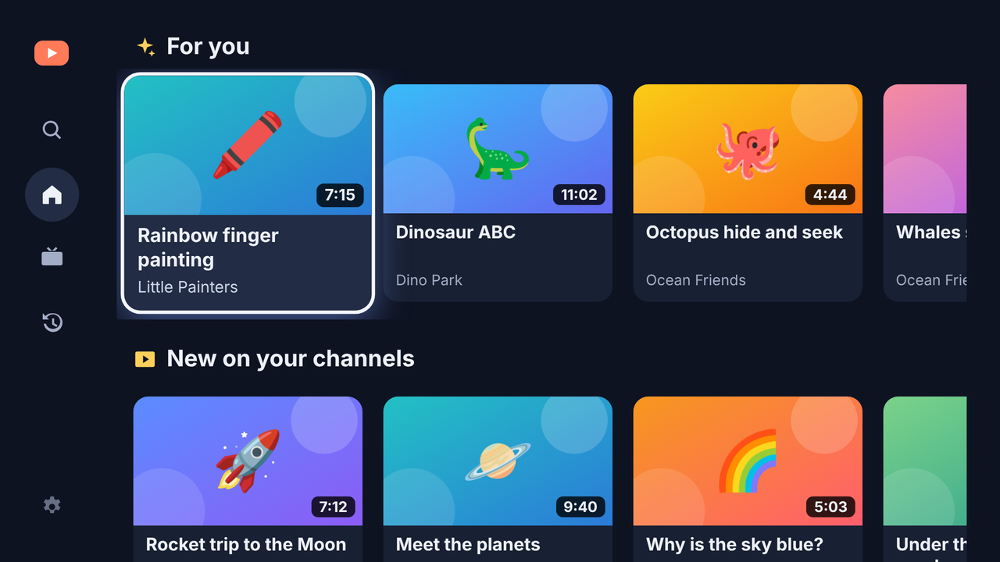<br><sub>Home: “For you”, new videos from subscribed channels, watch again</sub></td>
<td width="50%">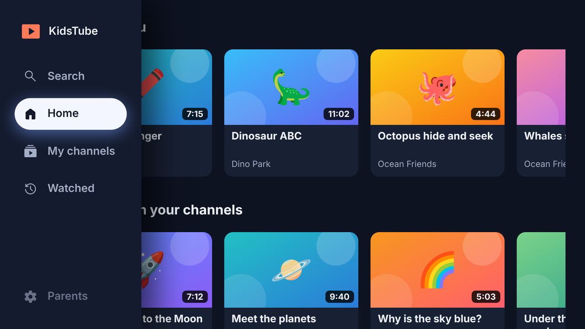<br><sub>Side menu (◀ at the left edge)</sub></td>
</tr>
<tr>
<td width="50%">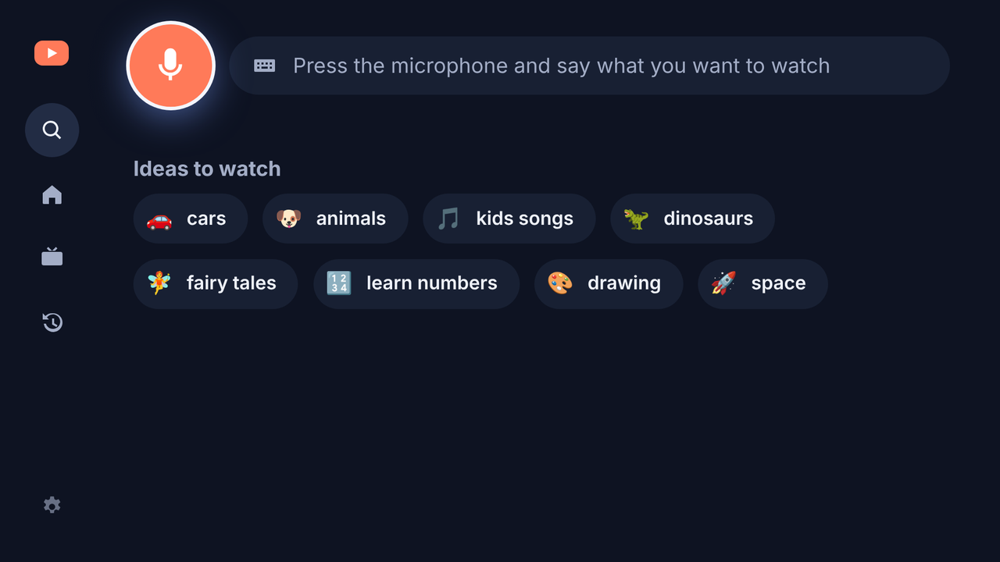<br><sub>Search: big microphone and one-press ideas</sub></td>
<td width="50%">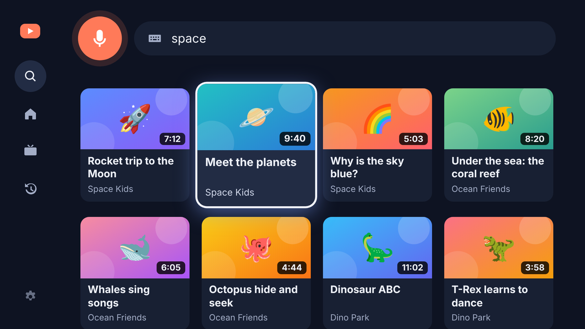<br><sub>Search results — already filtered</sub></td>
</tr>
<tr>
<td width="50%">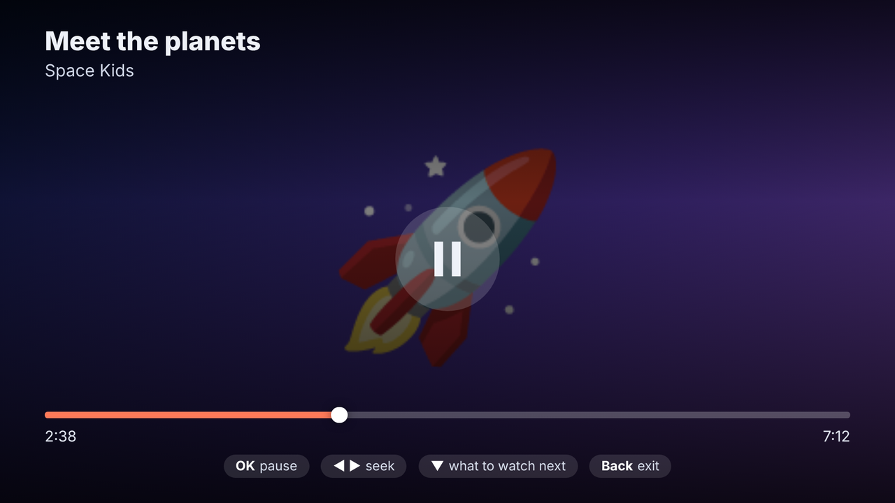<br><sub>Player: pause and seek with the remote</sub></td>
<td width="50%">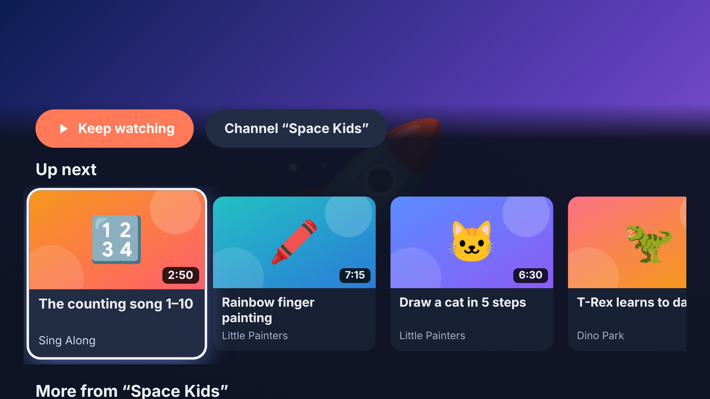<br><sub>▼ while watching: up next and more from the channel</sub></td>
</tr>
<tr>
<td width="50%">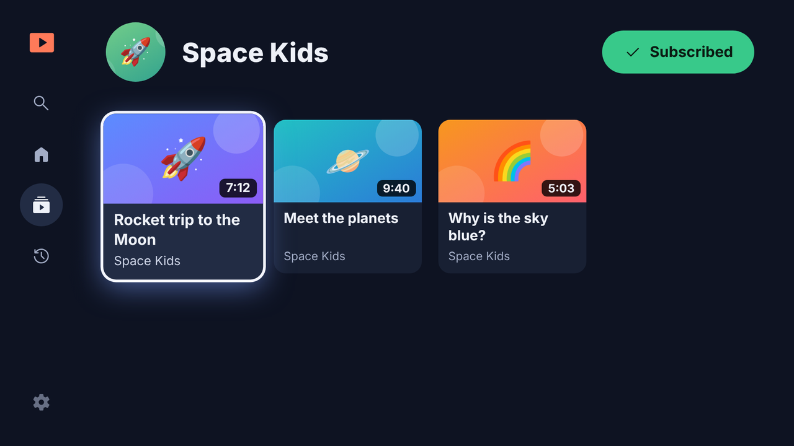<br><sub>Channel page with the Subscribe button</sub></td>
<td width="50%">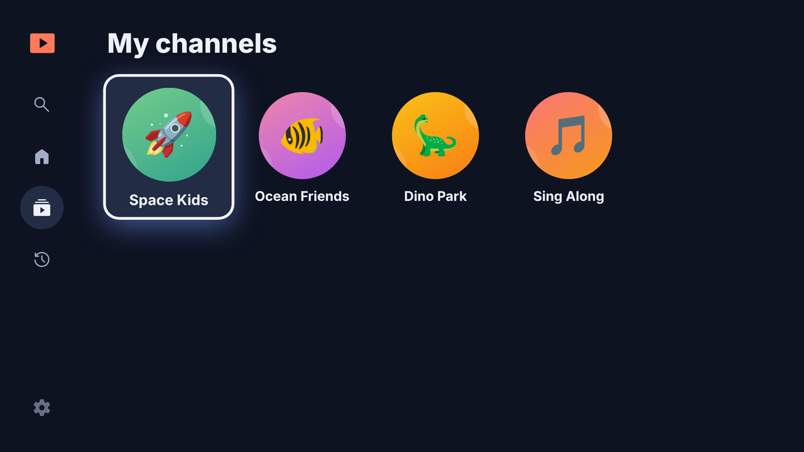<br><sub>My channels</sub></td>
</tr>
<tr>
<td width="50%">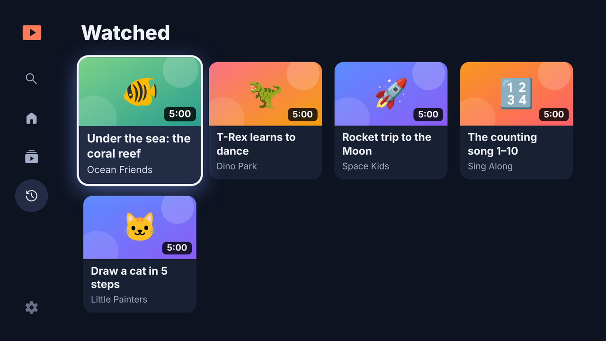<br><sub>Watched</sub></td>
<td width="50%">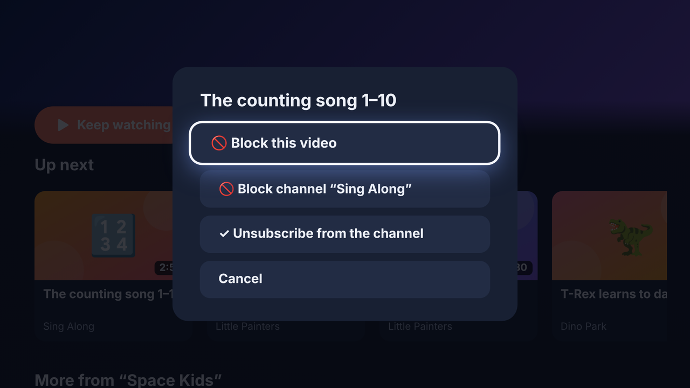<br><sub>Parent menu (long-press OK, PIN): block a video or channel</sub></td>
</tr>
<tr>
<td width="50%">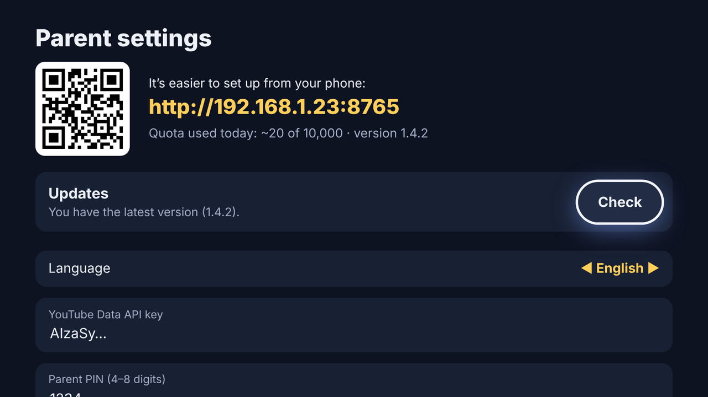<br><sub>Parent settings on the TV: updates, language, filters</sub></td>
</tr>
</table>

<p>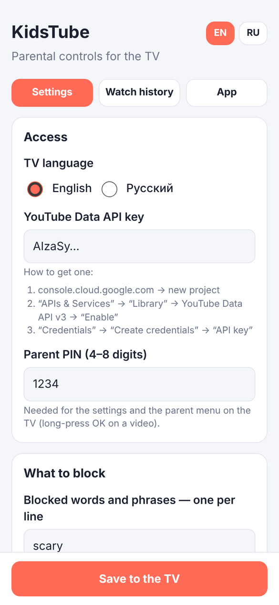 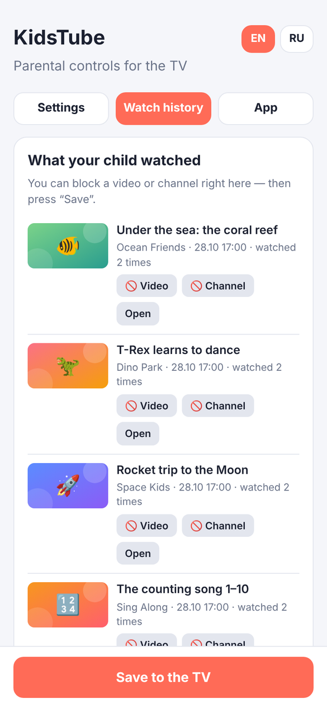 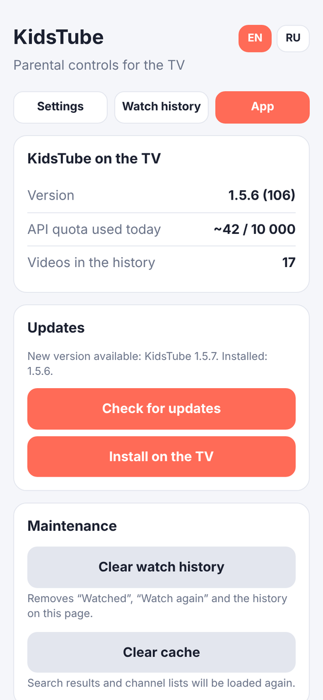</p>

<sub>Phone: settings · Phone: watch history with one-tap blocking · Phone: version, updates and maintenance</sub>

## What the child sees

A side menu (press ◀ at the left edge of any screen) with four sections:

- **Search** — a big microphone button plus one-press idea chips and recent searches, so no typing is needed;
- **Home**:
  - **For you** — YouTube's recommendations for recently watched videos (already watched ones are skipped);
  - **New on your channels** — the latest videos from every channel the child subscribed to (the "⭐ Subscribe" button on a channel page);
  - **Watch again** and **My channels**;
- **My channels** — all subscriptions;
- **Watched** — the viewing history.

Videos play in the official YouTube player, but without its interface: there's no way into comments or the YouTube site. Instead of YouTube's suggestions the app shows its own, **filtered as well**:

- **▼ while watching** opens "Up next" and "More from this channel", plus a button to open the channel;
- when a video ends, the panel opens by itself (or the next video starts — configurable);
- **channel pages** list all of a channel's videos. Blocked channels can't be opened.

The **watch history** is stored on the box (last 300 videos: when and how many times). Parents see it on their phone in the "Watch history" tab and can block a video or channel right from there.

## Installing on the TV box

1. Download `KidsTube.apk` from **Releases → latest** in this repository.
2. Copy it to the box in any way:
   - the **Send Files to TV** app (on Google Play for both the TV and the phone);
   - a USB stick and a file manager on the TV (for example, X-plore);
   - over the network with adb: `adb connect <box-IP>` → `adb install KidsTube.apk`.
3. On the first install, allow installs from unknown sources for the file manager (the TV will ask).

Later versions install from inside the app (see [Updates](#updates)).

## First setup

On first launch the TV shows an address like `http://192.168.1.23:8765` and a QR code. Open it on a phone on the same Wi‑Fi network and fill in:

- the **YouTube Data API key** (how to get one — below);
- the **parent PIN** (4–8 digits) — it protects the settings and the parent menu on the TV;
- blocked words and channels, subscriptions for the home screen, the TV language.

You can change the settings from the phone at any time while KidsTube is open on the TV; they apply immediately. **Everything available in the TV settings is also on the phone page**, in three tabs:

- **Settings** — every option: language, API key, PIN, blocked words/channels/videos, where to look for words, filters, subscriptions and collections, autoplay;
- **Watch history** — what was watched, with one-tap blocking;
- **App** — version, quota used today, check for updates and install them on the TV (confirm on the TV screen), clear the watch history or the cache.

### YouTube Data API key

1. [console.cloud.google.com](https://console.cloud.google.com) → create a project.
2. "APIs & Services" → "Library" → **YouTube Data API v3** → "Enable".
3. "Credentials" → "Create credentials" → **API key**.
4. (Recommended) restrict the key to YouTube Data API v3 in its settings.

No credit card is needed.

### Where videos come from and what it costs

- **Search and recommendations** use YouTube's internal API (the same one youtube.com, SmartTube and NewPipe use) — no key, no quota.
- **Every video is checked** (tags, "made for kids" flag, duration) through the official YouTube Data API with your key: 1 unit per 50 videos. Out of the 10,000 free daily units, that's thousands of searches.
- The internal API is unofficial and changes from time to time. If it stops responding, the app switches to the official search on its own (100 units per search, about 100 searches a day), and "Up next" is built from the title's key words. The child won't notice.

## Remote control

| Where | Button | Action |
|---|---|---|
| Everywhere | arrows / OK | move / select |
| Everywhere | ◀ at the left edge | open the side menu |
| Everywhere | Back | previous screen; on Home — the side menu, then exit |
| On a video | **long-press OK** (or Menu) | parent menu (PIN): block the video or channel, subscribe |
| Player | OK / Play | pause |
| Player | ◀ ▶ | seek 10 seconds |
| Player | ▼ | up next, more from the channel, open the channel |
| Player | Back | leave the video |
| Search | 🎤 on screen (or the remote's search key) | voice search |

## Keeping the filter from being bypassed

Disable the stock YouTube apps on the box (no root needed, via adb from a computer or phone):

```
adb connect <box-IP>
adb shell pm disable-user --user 0 com.google.android.youtube.tv
adb shell pm disable-user --user 0 com.google.android.youtube.tvkids
```

To restore: `adb shell pm enable com.google.android.youtube.tv`.

## Updates

In the TV settings ("Parents" → "Updates") the app checks the latest GitHub release of `hametovbr/kidstube` (set in `Updater.java`) and installs the new version. It also checks by itself every 12 hours and shows a yellow dot on the "Parents" menu item. On the first update Android asks to allow KidsTube to install apps. Updates need the releases to be downloadable without signing in, so the repository must be public.

## How it works

- `app/src/main/java/…/MainActivity.java` — full-screen WebView, remote keys forwarded to the UI, voice input, update installation.
- `app/src/main/java/…/InnerTube.java` — search and "up next" through YouTube's internal API (video IDs only).
- `app/src/main/java/…/Store.java` — settings, language and watch history.
- `app/src/main/java/…/SettingsServer.java` — a small web server on the local network for phone settings (everything behind the PIN; 5 wrong attempts lock it for a minute).
- `app/src/main/java/…/Updater.java` — in-app updates from GitHub releases.
- `app/src/main/assets/web/` — the TV interface (`index.html`, `app.js`, `app.css`, translations in `i18n.js`) and the phone settings page (`remote.html`).
- The filter is `blockReason()` in `app.js`. For every video found, the app fetches its full details (tags, "made for kids", duration) before deciding whether to show it.

### Interface design

The TV interface follows the Android TV and Fire TV design guidelines:

- 960×540 dp canvas, 48 dp side / 27 dp top-bottom safe area;
- a persistent side menu instead of a top bar that scrolls away; Back from content returns to the menu;
- one axis per purpose: up/down moves between rows, left/right moves within a row; each row remembers its last focused item;
- a clear focus state visible from across the room (scale, outline and glow) and short "pressed" feedback;
- a dark, low-glare palette with bright colour reserved for focus;
- icons and pictures alongside text, voice and one-press chips instead of typing — the main users can't read well yet;
- skeleton placeholders while loading and friendly empty states.

## Building

GitHub Actions builds the APK on every push to `main` and publishes it as the `latest` release (the release notes contain `versionCode: N`, which the updater reads). Locally: `gradle :app:assembleRelease` (JDK 17 and Android SDK 34).

### Signing key

Release APKs are signed in CI with a private key that is **not** in the repository. It lives in two repository secrets (Settings → Secrets and variables → Actions):

| Secret | Value |
|---|---|
| `KEYSTORE_BASE64` | the keystore file, base64-encoded (`base64 -w0 kidstube-release.jks`) |
| `KEYSTORE_PASSWORD` | the keystore and key password (key alias `kidstube`) |

Every build is signed with the same key, so a new version installs over the old one and keeps the settings. Keep a backup of the keystore and password: if they are lost, the next version can only be installed after uninstalling the app. Without the secrets (for example, a local build) the release APK is signed with the debug key.
