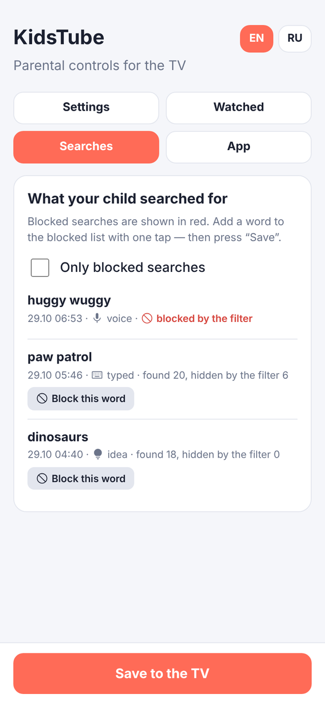
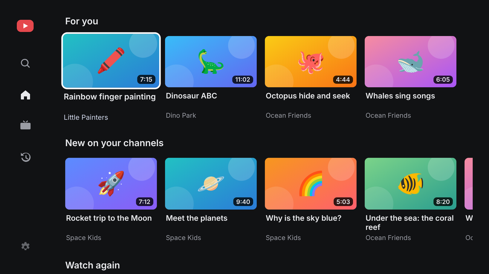
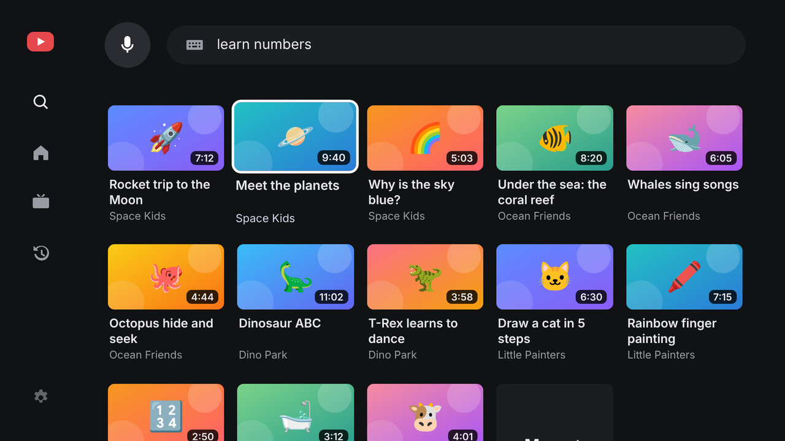
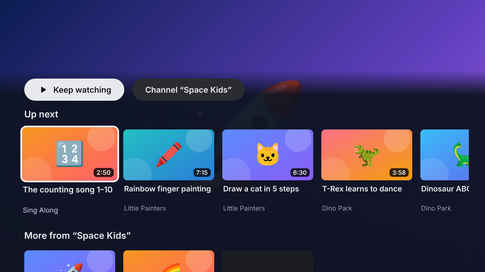
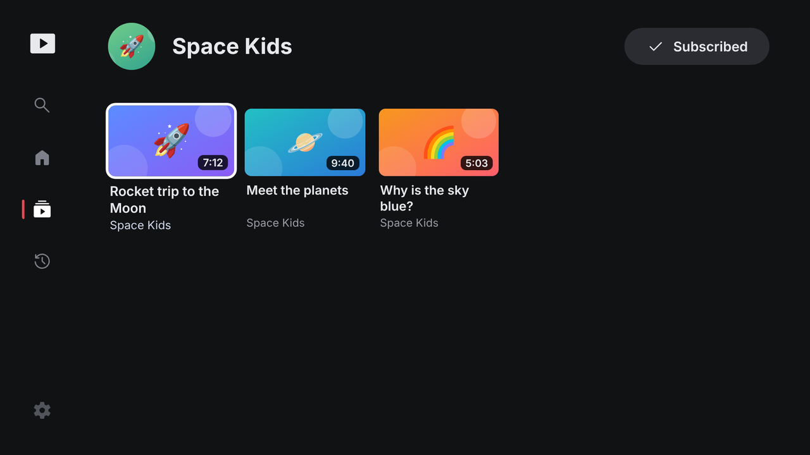

# KidsTube — YouTube для детей с фильтром по словам (Android TV)

[English version](README.md)

Приложение для приставки на Android TV. Ребёнок сам ищет видео (голосом или пультом), а KidsTube скрывает всё, что попадает под родительские правила:

- **запрещённые слова** в названии, тегах, описании или названии канала (часть слова тоже срабатывает: `страш` скроет «страшилки»);
- **заблокированные каналы и отдельные видео**;
- по желанию — только видео с пометкой YouTube «для детей», без очень коротких роликов;
- поиск YouTube всегда идёт в безопасном режиме.

Интерфейс на **английском** (по умолчанию) и **русском** и в двух стилях — **детский** (яркий и крупный) и **6+** (спокойный и компактный). Оба переключаются в родительских настройках.

## Скриншоты

*Демо-данные, интерфейс на английском; в приложении — настоящие видео YouTube, язык переключается на русский в настройках.*

<table>
<tr>
<td width="50%"><br><sub>Главная: «Для тебя», новое на каналах из подписок, смотреть снова</sub></td>
<td width="50%"><br><sub>Боковое меню (◀ у левого края)</sub></td>
</tr>
<tr>
<td width="50%"><br><sub>Поиск: большой микрофон и идеи в одно нажатие</sub></td>
<td width="50%"><br><sub>Результаты поиска — уже отфильтрованы</sub></td>
</tr>
<tr>
<td width="50%"><br><sub>Плеер: пауза и перемотка с пульта</sub></td>
<td width="50%"><br><sub>▼ во время просмотра: похожие видео и ещё с канала</sub></td>
</tr>
<tr>
<td width="50%"><br><sub>Страница канала с кнопкой «Подписаться»</sub></td>
<td width="50%"><br><sub>Мои каналы</sub></td>
</tr>
<tr>
<td width="50%"><br><sub>Я смотрел</sub></td>
<td width="50%"><br><sub>Родительское меню (долгое нажатие OK, PIN): заблокировать видео или канал</sub></td>
</tr>
<tr>
<td width="50%"><br><sub>Настройки для родителей на ТВ: обновления, язык, фильтры</sub></td>
</tr>
</table>

<p>   </p>

<sub>Телефон: настройки · Телефон: история просмотров с блокировкой в одно нажатие · Телефон: журнал поисков · Телефон: версия, обновления и обслуживание</sub>

### Стили интерфейса

**Детский** (по умолчанию) сделан для малышей: крупные карточки (3½ в ряд), яркие акценты, светящийся фокус, эмодзи на подсказках, «дышащий» микрофон.

**6+** — для детей постарше, которым детский стиль кажется «малышовым». Он ближе к обычному видеосервису: нейтральные серые тона вместо цветных, карточки мельче и плотнее (4½ в ряд, в сетках 5), тонкая белая рамка фокуса без свечения, без эмодзи и анимаций, мельче шрифты и кнопки, без подсказок по пульту в плеере. Переключается в настройках для родителей на ТВ или на телефоне («Стиль интерфейса»).

<table>
<tr>
<td width="50%"><br><sub>6+ — главная</sub></td>
<td width="50%"><br><sub>6+ — результаты поиска (5 в ряд)</sub></td>
</tr>
<tr>
<td width="50%"><br><sub>6+ — «Похожие» во время просмотра</sub></td>
<td width="50%"><br><sub>6+ — страница канала</sub></td>
</tr>
</table>

## Что видит ребёнок

Боковое меню (◀ у левого края любого экрана) с четырьмя разделами:

- **Поиск** — большая кнопка микрофона и подсказки-«пузыри» с идеями и недавними поисками, печатать не нужно;
- **Главная**:
  - **«Для тебя»** — рекомендации YouTube к недавно просмотренным видео (уже просмотренное не повторяется);
  - **«Новое на твоих каналах»** — свежие видео со всех каналов, на которые подписан ребёнок (кнопка «⭐ Подписаться» на странице канала);
  - **«Смотреть снова»** и **«Мои каналы»**;
- **Мои каналы** — все подписки;
- **Я смотрел** — история просмотров.

Видео проигрываются официальным плеером YouTube, но без его интерфейса: нельзя уйти в комментарии или на сайт YouTube. Вместо рекомендаций YouTube — свои, **тоже прошедшие фильтр**:

- **▼ во время просмотра** открывает «Похожие видео» и «Ещё с канала», а также кнопку перехода на канал;
- после окончания видео панель открывается сама (или включается следующее видео — настраивается);
- **страница канала** со всеми его видео. Заблокированные каналы открыть нельзя.

**История просмотров** хранится на приставке (последние 300 видео: когда и сколько раз смотрели). Родитель видит её на телефоне во вкладке «История просмотров» и может оттуда сразу заблокировать видео или канал.

## Установка на приставку

1. Скачайте `KidsTube.apk` в разделе **Releases → latest** этого репозитория.
2. Перенесите на приставку любым способом:
   - приложение **Send Files to TV** (есть в Google Play и на ТВ, и на телефоне);
   - флешка + файловый менеджер на ТВ (например, X-plore);
   - по сети через adb: `adb connect <IP-приставки>` → `adb install KidsTube.apk`.
3. При первой установке разрешите установку из неизвестных источников для файлового менеджера (ТВ сам предложит).

Следующие версии ставятся из самого приложения (см. [Обновления](#обновления)).

## Первая настройка

При первом запуске на экране появится адрес вида `http://192.168.1.23:8765` и QR-код. Откройте его на телефоне в той же Wi-Fi сети и заполните:

- **ключ YouTube Data API** (как получить — ниже);
- **PIN родителя** (4–8 цифр) — защищает настройки и родительское меню на ТВ;
- запрещённые слова и каналы, подписки для главного экрана, язык на телевизоре.

Настройки можно менять с телефона в любой момент, пока KidsTube открыт на ТВ — они применяются сразу. **Всё, что есть в настройках на ТВ, доступно и на телефоне**, в четырёх вкладках:

- **Настройки** — все параметры: язык, стиль интерфейса, ключ API, PIN, запрещённые слова/каналы/видео, где искать слова, фильтры, подписки и подборки, автовоспроизведение;
- **Просмотры** — что смотрели, с блокировкой видео или канала в одно нажатие;
- **Поиски** — всё, что ребёнок искал (голосом, текстом или через подсказку), и сколько результатов скрыл фильтр; заблокированные поиски выделены, любой запрос можно одним нажатием добавить в запрещённые слова;
- **Приложение** — версия, квота за сегодня, обновления (установка на ТВ после подтверждения на его экране), **резервная копия и восстановление** (один JSON-файл со всеми настройками, историей просмотров и журналом поисков — в нём ключ API и PIN, никому его не отправляйте), очистка истории, журнала поисков и кэша.

### Ключ YouTube Data API

1. [console.cloud.google.com](https://console.cloud.google.com) → создать проект.
2. «API и сервисы» → «Библиотека» → **YouTube Data API v3** → «Включить».
3. «Учётные данные» → «Создать учётные данные» → **Ключ API**.
4. (Рекомендуется) в настройках ключа ограничьте его только YouTube Data API v3.

Банковская карта не нужна.

### Откуда берутся видео и сколько это стоит

- **Поиск и рекомендации** идут через внутренний API YouTube (тот же, что у сайта youtube.com, SmartTube и NewPipe) — без ключа и без квоты.
- **Проверка каждого видео** (теги, пометка «для детей», длительность) — через официальный YouTube Data API по вашему ключу: 1 единица за 50 видео. Из 10 000 бесплатных единиц в сутки это тысячи поисков.
- Внутренний API неофициальный и иногда меняется. Если он перестал отвечать, приложение само переключается на официальный поиск (100 единиц за поиск, ≈100 поисков в день), а «Похожие» подбирает по словам из названия. Ребёнок этого не заметит.

## Пульт

| Где | Кнопка | Действие |
|---|---|---|
| Везде | стрелки / OK | навигация / выбор |
| Везде | ◀ у левого края | открыть боковое меню |
| Везде | Назад | предыдущий экран; на главной — меню, затем выход |
| На видео | **долгое нажатие OK** (или Menu) | родительское меню (PIN): заблокировать видео или канал, подписаться |
| Плеер | OK / Play | пауза |
| Плеер | ◀ ▶ | перемотка на 10 секунд |
| Плеер | ▼ | похожие видео, ещё с канала, переход на канал |
| Плеер | Назад | выход из видео |
| Поиск | 🎤 на экране (или кнопка поиска на пульте) | голосовой поиск |

## Чтобы ребёнок не обходил фильтр

Отключите стандартные приложения YouTube на приставке (без root, через adb с компьютера или телефона):

```
adb connect <IP-приставки>
adb shell pm disable-user --user 0 com.google.android.youtube.tv
adb shell pm disable-user --user 0 com.google.android.youtube.tvkids
```

Вернуть: `adb shell pm enable com.google.android.youtube.tv`.

## Обновления

В настройках на ТВ («Родителям» → «Обновления») приложение проверяет последний релиз `hametovbr/kidstube` на GitHub (адрес задан в `Updater.java`) и ставит новую версию. Раз в 12 часов проверка идёт сама, а у пункта «Родителям» появляется жёлтая точка. При первом обновлении Android попросит разрешить KidsTube устанавливать приложения. Для обновлений релизы должны скачиваться без входа, поэтому репозиторий должен быть публичным.

## Как устроено

- `app/src/main/java/…/MainActivity.java` — WebView на весь экран, передача кнопок пульта в интерфейс, голосовой ввод, установка обновлений.
- `app/src/main/java/…/InnerTube.java` — поиск и рекомендации через внутренний API YouTube (только ID видео).
- `app/src/main/java/…/Store.java` — настройки, язык и история просмотров.
- `app/src/main/java/…/SettingsServer.java` — маленький веб-сервер в локальной сети для настроек с телефона (всё под PIN, 5 неверных попыток — блокировка на минуту).
- `app/src/main/java/…/Updater.java` — обновления из релизов GitHub.
- `app/src/main/assets/web/` — интерфейс для ТВ (`index.html`, `app.js`, `app.css`, переводы в `i18n.js`) и страница настроек для телефона (`remote.html`).
- Фильтр: `blockReason()` в `app.js`. Для каждого найденного видео приложение дозапрашивает полные данные (теги, пометку «для детей», длительность) и только потом решает, показывать ли его.

### Дизайн интерфейса

Интерфейс сделан по рекомендациям Android TV и Fire TV:

- холст 960×540 dp, безопасные поля 48 dp по бокам и 27 dp сверху и снизу;
- постоянное боковое меню вместо верхней панели, которая уезжает при прокрутке; «Назад» из контента возвращает в меню;
- у каждой оси своя роль: вверх/вниз — между рядами, влево/вправо — внутри ряда; каждый ряд помнит, где был фокус;
- заметный с дивана фокус (увеличение, обводка, свечение) и короткий отклик на нажатие;
- тёмная палитра без слепящего белого, яркий цвет — только для фокуса;
- иконки и картинки рядом с текстом, голос и «пузыри» вместо набора текста — главные пользователи ещё плохо читают;
- «скелетоны» во время загрузки и понятные пустые состояния.
- **Иконки** — только [Material Symbols](https://fonts.google.com/icons) (Rounded, лицензия Apache 2.0) из одного набора; эмодзи и текстовые стрелки как иконки не используются, поэтому всё выглядит одинаково на любой приставке.

## Сборка

GitHub Actions собирает APK при каждом пуше в `main`. Новый релиз `latest` публикуется только когда версия в `version.properties` повышена (в описании релиза есть строка `versionCode: N`, её читает обновлятор); остальные пуши только собираются и проверяются. Правила версий — в [AGENTS.md](AGENTS.md#versioning). Локально: `gradle :app:assembleRelease` (нужны JDK 17 и Android SDK 34).

### Ключ подписи

Релизные APK подписываются в CI закрытым ключом, которого **нет** в репозитории. Он хранится в двух секретах репозитория (Settings → Secrets and variables → Actions):

| Секрет | Значение |
|---|---|
| `KEYSTORE_BASE64` | файл ключа в base64 (`base64 -w0 kidstube-release.jks`) |
| `KEYSTORE_PASSWORD` | пароль хранилища и ключа (псевдоним ключа `kidstube`) |

Все сборки подписаны одним ключом, поэтому новая версия ставится поверх старой с сохранением настроек. Храните копию ключа и пароля: если их потерять, следующую версию можно будет поставить только после удаления приложения. Без секретов (например, при локальной сборке) релизный APK подписывается отладочным ключом.
